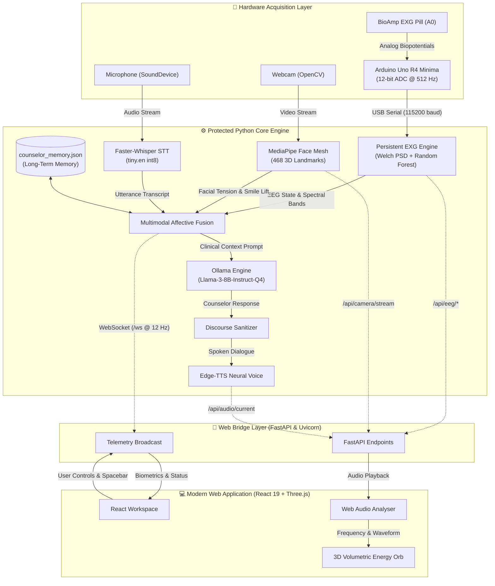
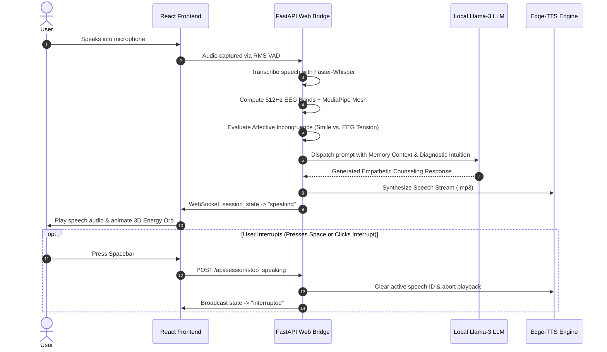

<div align="center">

# 🧠⚡ PROJECT KAI
### *Knowledgeable Affective Intelligence*
**A 100% Offline, Multimodal Prefrontal EEG Brain-Computer Interface & Empathetic AI Counselor**

[](https://www.python.org/)
[](https://react.dev/)
[](https://www.typescriptlang.org/)
[](https://threejs.org/)
[](https://fastapi.tiangolo.com/)
[](https://www.arduino.cc/)
[](https://ollama.com/)
[](https://tailwindcss.com/)
[](https://github.com/)
[](https://opensource.org/licenses/MIT)

<br/>

<p align="center">
  <b>Project KAI bridges real-time prefrontal biopotentials (EEG), computer vision micro-expression tracking (468 landmarks), and vocal prosody into a closed-loop, on-device affective counseling companion.</b>
</p>

[✨ Key Features](#-key-features) •
[🏛️ System Architecture](#️-system-architecture) •
[⚡ Quick Launch](#-quick-launch-1-click) •
[🔌 Hardware Wiring](#-hardware-setup--wiring) •
[💻 Tech Stack](#-technology-stack) •
[🕹️ Workspace Modes](#-workspace-modes) •
[📜 License](#-license--accreditations)

---

</div>

## 📸 Visual Showcase

<div align="center">

| 3D Volumetric KAI Energy Orb (WebGL Point Cloud) | Real-Time Biometric Vision & Landmark Mesh |
| :---: | :---: |
|  |  |
| *Procedural Three.js organic particle orb driven by Web Audio API frequencies* | *468-point 3D facial mesh with dynamic baseline tension tracking* |

</div>

---

## 🎯 Executive Summary & Problem Statement

### The Problem
Traditional digital mental health platforms suffer from two major flaws:
1. **Subjective Bias & Emotional Masking:** Users frequently mask psychological distress (smiling or downplaying anxiety during verbal self-reporting), leaving standard chatbots and telehealth tools blind to true internal cognitive load.
2. **Severe Privacy & Surveillance Risks:** Transmitting real-time video matrices, microphone recordings, emotional logs, and biometric telemetry to remote cloud servers creates acute vulnerabilities for private psychological data.

### The KAI Solution
**Project KAI (Knowledgeable Affective Intelligence)** is an edge-native, zero-cloud desktop and web ecosystem that pairs low-cost biomedical hardware (**BioAmp EXG Pill + Arduino Uno R4 Minima**) with local GPU-accelerated neural models. By analyzing prefrontal cortex electrical activity alongside facial action units and speech prosody, KAI objectively detects emotional incongruence and delivers radical validation therapy without a single byte leaving the user's local machine.

```
┌────────────────────────────────────────────────────────────────────────┐
│                   TRADITIONAL APPS vs. PROJECT KAI                     │
├──────────────────────────┬─────────────────────────────────────────────┤
│ ❌ Cloud-dependent       │ ✅ 100% Offline (Local Llama-3 + Whisper)    │
│ ❌ Subjective chat only  │ ✅ Multimodal Grounding (512Hz EEG + Vision) │
│ ❌ Fooled by fake smiles │ ✅ Affective Masking Detection Engine       │
│ ❌ High cloud latency    │ ✅ Sub-second Real-time Local Response      │
│ ❌ Monthly subscriptions │ ✅ Open-source & Low-Cost DIY Hardware      │
└──────────────────────────┴─────────────────────────────────────────────┘
```

---

## ✨ Key Features

### 1. 🧠 High-Precision Prefrontal EEG Telemetry & In-Browser Training
- **512 Hz Hardware Sampling:** Streams 12-bit ADC biopotentials from the prefrontal cortex (forehead $F_{pz}$) using an Arduino Uno R4 Minima via USB serial.
- **Spectral Power Density:** Computes real-time Welch PSD across:
  - **Theta ($4–8\text{ Hz}$):** Deep meditation, drowsiness, or memory access.
  - **Alpha ($8–13\text{ Hz}$):** Calm, relaxed alertness.
  - **Beta ($13–30\text{ Hz}$):** Active concentration, analytical thinking, or stress.
  - **Arousal Ratio ($\beta / \alpha$):** Real-time quantitative marker of sympathetic nervous arousal.
- **In-Browser Dataset Recording & Retraining:** Directly record labeled calibration samples (`Relaxed`, `High_Load`, `Fatigued`, `Agitated`) and retrain the Scikit-Learn Random Forest model (`eeg_model.pkl`) live from the web UI.

### 2. 👁️ 468-Landmark Biometric Vision & Dynamic Calibration
- **MediaPipe Face Mesh:** Tracks 468 3D facial landmarks at 30 FPS via OpenCV and MediaPipe Tasks.
- **Self-Calibrating Baseline Engine:** Uses the first 90 frames to compute individual facial geometry baselines, preventing misdiagnosis from natural resting expressions.
- **Facial Action Unit Telemetry:** Measures continuous eyebrow contraction (corrugator supercilii tension) and smile lift (zygomaticus major activation).

### 3. 🎭 Affective Incongruence / Masking Detection
- Identifies disparities between outward emotional expression and inward physiological state.
- **Example Scenario:** A user smiles while talking about their day, but their prefrontal EEG registers extreme beta power and cognitive fatigue.
- KAI's clinical persona identifies the facade and responds with radical validation:
  > *"I hear what you're saying, and I can see you smiling, but I know how heavy things actually feel right now. You don't have to carry this alone."*

### 4. 🌐 Procedural 3D KAI Energy Orb (Three.js WebGL)
- Central organic point-cloud entity rendered with custom WebGL shaders.
- **Dynamic Color Harmony:** Electric cyan and azure top surface curving into neon violet and radiant magenta under-surface.
- **Audio-Reactive:** Connected directly to the browser's Web Audio API `AnalyserNode`, pulsing and rippling to the frequency spectrum of KAI's speech synthesis.
- **Autonomous State Machine:** Displays distinct fluid animations for *Idle Breathing*, *Attentive Listening*, *Cognitive Reflection (Swirl)*, and *Empathetic Warmth*.

### 5. 🎙️ Natural Voice Pipeline with Instant Barge-In
- **RMS Voice Activity Detection (VAD):** Listens via `sounddevice` with automatic silence cut-offs.
- **Offline Speech-to-Text:** Faster-Whisper (`tiny.en` int8 quantized) provides sub-second on-device transcription.
- **Neural Speech Synthesis:** Edge-TTS generating human-like counseling voices (`en-IN-PrabhatNeural`).
- **Instant Speech Interruption:** Press <kbd>Spacebar</kbd> or click the **"Interrupt Speech"** button to immediately halt audio playback, reset the 3D entity, and yield the floor back to the user without restarting the session.

### 6. 🔒 100% Air-Gapped Data Privacy & Long-Term Memory
- **Persistent Psychological Memory:** Saves session summaries, user profile, recurring stressors, and emotional trajectories in `counselor_memory.json`.
- **Absolute Privacy:** Audio, video, EEG voltages, and personal counseling exchanges never leave your local RAM/GPU.

---

## 🏛️ System Architecture

### Multimodal Pipeline Overview



### Conversational Session Sequence



---

## ⚡ Quick Launch (1-Click)

### Option A: The Easy One-Click Launcher (Windows)
Double-click the pre-configured batch file in the repository root:
```cmd
start_web.bat
```
This automatically initializes the background core, mounts the high-speed FastAPI web bridge, and serves the pre-built React frontend at:
👉 **`http://localhost:8000`**

---

### Option B: Step-by-Step Manual Setup

#### 1. Clone the Workspace
```bash
git clone https://github.com/YourUsername/JU-Techfest-Hackathon.git
cd "JU Techfest Hackathon"
```

#### 2. Flash the Arduino Firmware
1. Open the [Arduino IDE](https://www.arduino.cc/en/software).
2. Open [`KAI-Counselor-main/arduino_code.ino`](./KAI-Counselor-main/arduino_code.ino).
3. Select your board: **Arduino Uno R4 Minima** (or Uno R3 / Nano).
4. Verify the COM port in Device Manager (default: `COM10`).
5. Upload the sketch. *(Configures 12-bit ADC and 512 Hz timer sampling).*

#### 3. Setup Python Virtual Environment
```bash
# Navigate to core folder
cd KAI-Counselor-main

# Create and activate virtual environment
python -m venv venv
# On Windows:
.\venv\Scripts\activate
# On Linux / macOS:
source venv/bin/activate

# Install core dependencies
pip install fastapi uvicorn websockets pyserial numpy scipy scikit-learn pandas opencv-python mediapipe sounddevice faster-whisper edge-tts ollama pygame pillow joblib requests
```

#### 4. Configure & Start Ollama (Local LLM)
1. Download and install [Ollama](https://ollama.com/).
2. Pull the optimized quantized Llama-3 model:
   ```bash
   ollama pull llama3:8b-instruct-q4_K_M
   ```
3. Verify Ollama is running at `http://127.0.0.1:11434`.

#### 5. Launch the Web Bridge
```bash
python web_bridge.py
```
*The web bridge automatically serves the production React build on `http://127.0.0.1:8000`.*

#### 6. (Optional) Run Frontend in Vite Development Mode
If you wish to modify or develop the React interface live:
```bash
cd ../frontend
npm install
npm run dev
```
*Frontend hot-reloading dev server runs on `http://localhost:3000` or `http://localhost:5173`.*

---

## 🔌 Hardware Setup & Wiring

### 1. Pin Connections
Connect the **BioAmp EXG Pill** to the **Arduino Uno R4 Minima** as follows:

| BioAmp EXG Pill Pin | Arduino Uno R4 Pin | Description |
| :--- | :--- | :--- |
| **VCC** | `5V` (or `3.3V`) | Filtered DC supply |
| **GND** | `GND` | System Ground |
| **OUT** | `A0` | Raw amplified analog biopotential signal |

> [!NOTE]
> The Arduino Uno R4 Minima's 32-bit ARM Cortex-M4 microprocessor utilizes `analogReadResolution(12)`, providing 4,096 discrete levels of ADC voltage resolution for micro-volt EEG sensitivity.

### 2. 3-Lead Electrode Placement
For optimal prefrontal brain-computer interface signal fidelity:

```
                  [ Forehead Center (Fpz) ]
                           [ IN+ ]
                             │
     (Left Mastoid / Earlobe)     (Right Mastoid / Earlobe)
             [ IN- ]                       [ REF ]
```

1. **`IN+` (Active):** Clean skin on the center of the forehead ($F_{pz}$) using an alcohol prep wipe; attach standard gel Ag/AgCl electrode.
2. **`IN-` (Reference):** Clip or attach electrode to the left mastoid bone or earlobe.
3. **`REF` (Ground):** Attach electrode to the right mastoid bone or earlobe for common-mode rejection.

---

## 🕹️ Workspace Modes

KAI features two distinct operational workspaces selectable from the top navigation bar:

```
┌─────────────────────────────────┬─────────────────────────────────┐
│     1. Minimal Video Call Mode  │    2. Technical EEG Cockpit     │
├─────────────────────────────────┼─────────────────────────────────┤
│ • 80% focus on 3D KAI Energy Orb│ • Multi-column telemetry matrix │
│ • Floating PiP camera stream    │ • Live 468 MediaPipe video HUD  │
│ • Collapsible transcript drawer │ • Continuous Theta/Alpha/Beta   │
│ • Real-time subtitle captioning │ • In-Browser EEG sample trainer │
│ • Zero visual distractions      │ • Affective Incongruence badge  │
└─────────────────────────────────┴─────────────────────────────────┘
```

### Keyboard Shortcuts & Instant Interruption
- <kbd>Spacebar</kbd> : **Instant Speech Interruption** (Immediately cuts off KAI's voice and resumes listening).
- <kbd>Esc</kbd> : Secondary interruption key.
- **Top-Right PiP Toggle** : Minimizes or expands the live video feed without disrupting audio analysis.

---

## 💻 Technology Stack

| Layer | Technology | Purpose |
| :--- | :--- | :--- |
| **Microcontroller** | Arduino Uno R4 Minima | 32-bit RA4M1 ARM processor, 512 Hz microsecond sampling |
| **Analog Front-End** | BioAmp EXG Pill | Low-noise analog biopotential instrumentation amplifier |
| **Signal Processing** | NumPy, SciPy (Welch PSD, FFT) | Real-time extraction of Theta, Alpha, Beta band powers |
| **Biometric ML** | Scikit-Learn (Random Forest) | Real-time cognitive load & affective state prediction |
| **Computer Vision** | MediaPipe Face Mesh & OpenCV | 468-point 3D landmark mesh, brow & smile tension units |
| **Speech-to-Text** | Faster-Whisper (`tiny.en`) | Offline, quantized, sub-second speech transcription |
| **Text-to-Speech** | Edge-TTS (`en-IN-PrabhatNeural`)| High-fidelity natural prosody emotional voice synthesis |
| **Local LLM** | Ollama (`llama3:8b-instruct`) | On-device clinical counseling & cognitive behavioral therapy |
| **Web Server** | FastAPI, Uvicorn, WebSockets | Asynchronous telemetry streaming (~12 Hz) & MJPEG feed |
| **Frontend Framework** | React 19, TypeScript, Vite | Ultra-fast, reactive client interface |
| **Styling** | Tailwind CSS v4, Lucide Icons | Responsive glassmorphic cyber-aesthetic UI |
| **3D Graphics** | Three.js (WebGL) | Procedural volumetric point-cloud energy entity |

---

## 📂 Repository Structure

```text
JU Techfest Hackathon/
├── start_web.bat                     # 🚀 One-click launcher for complete web application
├── counselor_memory.json             # 🧠 Persistent psychological memory & chat logs
├── Screenshot 2026-10-24 045641.png  # 📸 3D Energy Orb screenshot
├── Screenshot 2026-10-23 205638.png  # 📸 Biometric Vision & Tkinter studio screenshot
│
├── frontend/                         # 💻 Modern React 19 + Three.js Web Application
│   ├── index.html                    # Single Page App entry point
│   ├── package.json                  # NPM dependencies & build scripts
│   ├── vite.config.ts                # Vite build and proxy configuration
│   ├── dist/                         # Compiled production assets served by FastAPI
│   └── src/
│       ├── App.tsx                   # Main dual-mode workspace coordinator
│       ├── components/
│       │   ├── KaiOrb.tsx            # Procedural Three.js audio-reactive 3D entity
│       │   ├── CameraPanel.tsx       # Live camera MJPEG view with 468 landmarks HUD
│       │   ├── BiometricsPanel.tsx   # Prefrontal EEG band power visualizers & ratio
│       │   ├── EEGTrainingPanel.tsx  # In-browser BioAmp dataset recording & retraining
│       │   ├── EmotionPanel.tsx      # Affective incongruence / masking detector
│       │   ├── ConversationPanel.tsx # Transcript drawer & clinical interaction history
│       │   ├── CallControls.tsx      # Video-conference action bar & stop speaking
│       │   └── TopBar.tsx            # Connection diagnostics & hardware status
│       ├── hooks/
│       │   └── useBackend.ts         # High-speed WebSocket connection & state engine
│       └── services/
│           ├── backendClient.ts      # REST API communication client
│           ├── eegClient.ts          # EEG training & calibration endpoints
│           └── audioManager.ts       # Web Audio API analyzer for reactive visuals
│
└── KAI-Counselor-main/               # ⚙️ Python Backend Core & Hardware Drivers
    ├── web_bridge.py                 # FastAPI server, WebSocket emitter & MJPEG streamer
    ├── eeg_adapter.py                # REST API router for EEG recording & model training
    ├── kai_interactive_core(arudino).py # Protected KAI core algorithms & fallback desktop UI
    ├── counselor_pipeline.py         # Standalone serial EEG pipeline utility
    ├── arduino_code.ino              # 512 Hz 12-bit ADC firmware for Arduino Uno R4
    ├── eeg_model.pkl                 # Pre-trained Random Forest affective state model
    ├── eeg_training_data.csv         # Calibration dataset for EEG state classification
    ├── face_landmarker.task          # MediaPipe Tasks vision model weights
    └── counselor_memory.json         # Active runtime memory file
```

---

## 📊 Technical Specifications & Benchmarks

| Parameter | Specification / Benchmark |
| :--- | :--- |
| **EEG Sampling Rate** | $512\text{ Hz}$ ($\Delta t = 1,953\,\mu\text{s}$ interval via hardware timer) |
| **ADC Resolution** | $12\text{-bit}$ ($0 - 4,095$ integer digital counts) |
| **Serial Baud Rate** | $115,200\text{ bps}$ USB CDC |
| **Vision Tracking** | $468\text{ points}$ (full 3D face mesh @ $30\text{ FPS}$) |
| **STT Latency** | $\sim 280\text{ ms}$ on CUDA (Faster-Whisper `tiny.en` int8) |
| **LLM Generation Speed** | $\sim 45\text{ tokens/second}$ on NVIDIA RTX 3070 ($8\text{ GB}$ VRAM) |
| **VRAM Consumption** | $\sim 5.2\text{ GB}$ (leaving $>2.5\text{ GB}$ for vision and OS) |
| **WebSocket Refresh** | $\sim 12\text{ Hz}$ continuous biometric telemetry packets |
| **Total Cloud Data Sent** | **$0\text{ Bytes}$ (Zero cloud egress / complete data sovereignty)** |

---

## 🛡️ Safety, Ethics & Privacy

- **Low-Voltage DC Operation:** The BioAmp EXG Pill operates strictly on low-voltage ($3.3\text{V} - 5\text{V}$) DC power derived from standard USB isolation, guaranteeing complete electrical safety during skin-contact electrophysiological measurements.
- **Non-Diagnostic Supportive Care:** KAI is designed as an affective biofeedback companion and psychological co-regulation assistant. It does not replace psychiatric emergency care, but empowers users with objective cognitive self-awareness and validated coping mechanisms.
- **Zero Third-Party Telemetry:** No analytics libraries, third-party tracking scripts, or cloud inference APIs are employed.

---

## 🏆 License & Accreditations

Project KAI was developed for national technical competitions and evaluations:
- **JU Techfest Hackathon**
- **INSPIRE Awards MANAK** *(Department of Science and Technology, Govt. of India)*
- **MNIT Jaipur** Technical Showcase
- **Vishwakarma Awards 2026** *(IIT Indore)*

Distributed under the **MIT License**. See [`LICENSE`](https://opensource.org/licenses/MIT) for more information.

<div align="center">
  <sub>Built with ❤️ for accessible, stigma-free, privacy-first mental health biofeedback.</sub>
</div>

